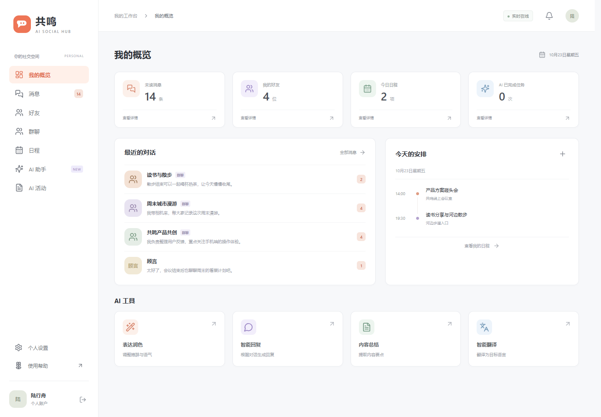
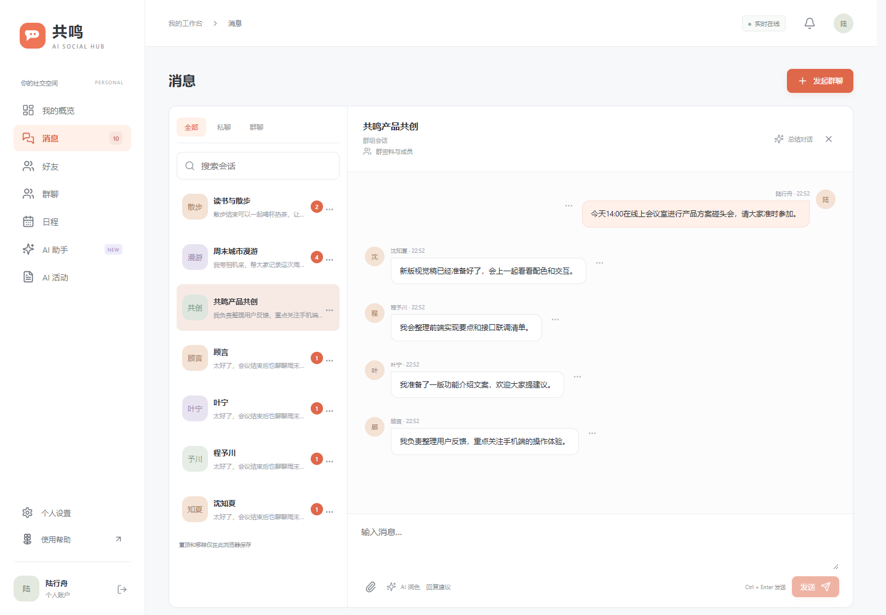
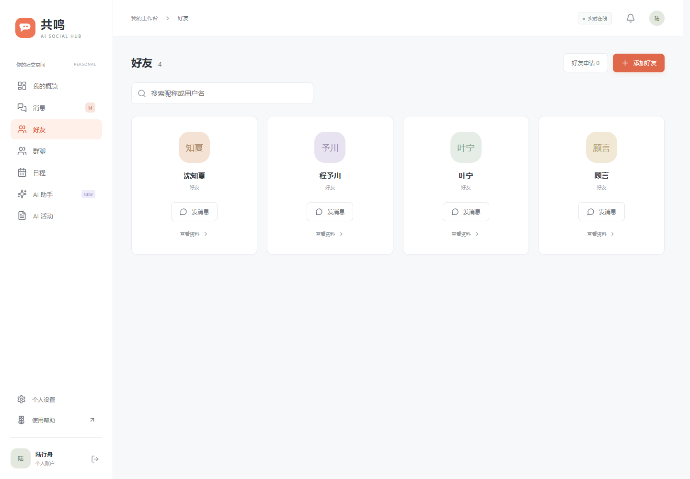
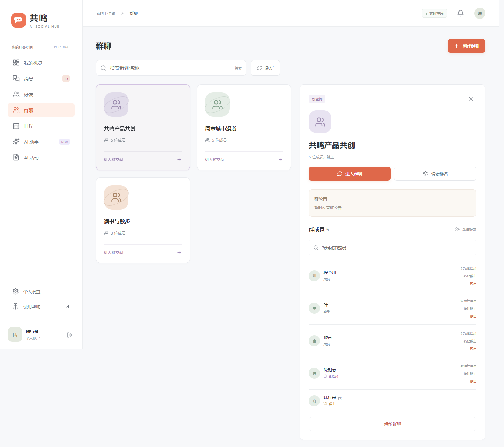
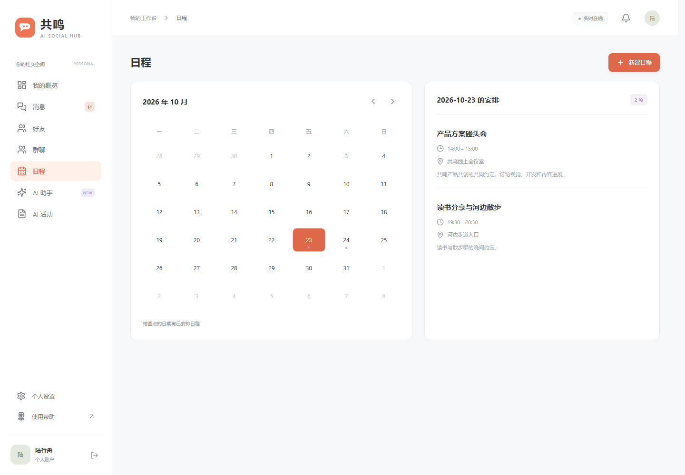
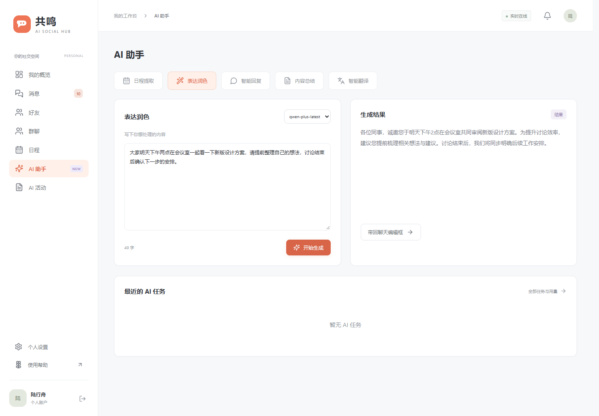

# 共鸣 · AI Social Hub

基于 Vue 3 与 Spring Boot 的 AI 社交协作项目，将私聊、群聊、好友关系、日程管理和 AI 辅助表达放在同一个工作台中。

## 项目目的

本项目面向朋友交流和小团队协作中的实际需求：对话记录与后续安排容易分散，消息表达、讨论整理和约定录入需要重复操作。因此，在完成基础社交功能的同时，将润色、回复建议、内容总结、翻译和日程提取嵌入业务流程。

工程上采用模块化后端，探索模型路由、受控工具调用、会话记忆、异步任务和 Prompt 防护如何与真实的身份、权限和数据持久化结合。当前是一个整合运行的多模块应用，前端独立构建和部署。

## 功能

| 功能 | 当前实现 |
| --- | --- |
| 身份与资料 | 注册、登录、退出、访问令牌与刷新令牌、昵称/邮箱/手机号/头像地址、修改密码 |
| 好友 | 用户名或手机号精确查找、同群联系人、发送/接受/拒绝/撤销申请、删除好友 |
| 消息 | 私聊与群聊、未读数、历史分页、SSE 实时推送、附件上传与鉴权下载 |
| 聊天操作 | 会话置顶/移除、消息多选/转发/本机隐藏；文件发送前预览名称和大小 |
| 群空间 | 创建、搜索、成员管理、邀请、管理员设置、群主转让、退出和解散 |
| 日程 | 月历、按日查看、新建、编辑、删除；AI 提取后由用户确认时间并保存 |
| AI 助手 | 文本润色、回复建议、内容总结、翻译、日程提取；聊天内直接使用 AI 结果 |
| AI 活动 | 任务记录与详情、状态筛选、模型用量、个人画像查询及清理 |
| 界面 | 中文界面、响应式布局、独立滚动的会话列表、表单就近提示和错误处理 |

聊天内润色会填入编辑框，回复建议需主动选用，均不会自动发送消息。会话置顶/移除和逐条消息隐藏保存在当前浏览器，并按账号隔离；它们不代表服务端记录被删除，也不在设备间同步。

## 页面预览

以下截图来自真实前端与后端，使用专门创建的虚构展示账号和关联数据。AI 助手截图包含真实模型生成的润色结果。截图是静态快照，不代表线上实时状态。

### 工作台

未读消息、好友、日程和 AI 工具集中展示。



### 私聊与群聊

左侧切换会话，右侧展示成员消息、未读数和聊天内 AI 操作。



### 好友



### 群空间



### 日程



### AI 助手



## 技术栈

| 层次 | 技术 |
| --- | --- |
| 前端 | Vue 3、TypeScript 5.7、Vue Router 4、Vite 6、Lucide 图标、CSS 响应式布局 |
| 后端 | Java 21、Spring Boot 3.5.5、Spring Web、WebFlux/Reactor |
| 身份与流量控制 | Spring Security、JJWT、BCrypt、Redis 令牌桶、Sentinel |
| 数据持久化 | PostgreSQL、MyBatis-Plus 3.5.9、JSONB、pgvector |
| 缓存与消息基础设施 | Spring Data Redis、Lettuce、Redis Stream、Lua |
| AI 接入 | 模型策略与目录配置、DashScope 兼容接口、OkHttp、SSE 流式生成 |
| 文件解析 | Apache Tika 2.9.2，授权聊天附件的限长文本提取 |
| 构建与验证 | Maven、npm、JUnit/Mockito、Node 测试、Playwright |
| 部署 | 可执行 JAR、Dockerfile、前端静态资源及反向代理 |

pgvector 用于画像表的向量字段和索引。当前会话记忆使用 Redis 窗口和摘要，不将向量字段的存在视为已经实现语义检索或完整 RAG。

## 架构与目录

```text
浏览器 / Vue
  ├─ REST：身份、好友、消息、群、日程、任务
  ├─ SSE：实时消息推送
  └─ SSE：AI 文本流
          │
Spring Boot 整合应用
  ├─ 身份认证、权限校验、入口限流
  ├─ 聊天 / 群管理 / 日程服务
  └─ AI 任务编排 → Prompt 组装 → 模型路由 → 供应商策略
                      │                      └─ 受控工具调用循环
                      ├─ Redis 会话窗口与摘要
                      └─ PostgreSQL 任务、画像、用量

Redis：刷新令牌、限流、会话记忆、异步任务流
PostgreSQL：用户、好友、会话、消息、附件元数据、日程、AI 业务记录
本地文件目录：聊天附件内容
```

| 目录 | 职责 |
| --- | --- |
| `ai-social-web` | Vue 前端、静态资源和前端构建 |
| `ai-social-app` | 应用启动、模块装配、跨模块桥接、容器构建 |
| `ai-social-gateway` | 安全过滤链、认证过滤和入口限流 |
| `ai-social-identity` | 账户、资料、好友与申请 |
| `ai-social-chat` | 会话、消息、群、附件与实时推送 |
| `ai-social-schedule` | 日程业务 |
| `ai-social-ai-engine` | 模型接入、任务编排、Prompt、工具、记忆和异步消费 |
| `ai-social-common` | 公共模型、异常、工具和模块间接口 |
| `docs` | 数据库初始化结构与页面图片 |
| `doc` | API/联调资料、缺陷反馈、验收记录和增量迁移 |

上述后端模块由 `ai-social-app` 统一启动；`gateway` 是应用内部的安全模块，不需要另行启动一个网关服务。

## Agent 机制

### ReAct-like 工具决策循环

这里的 ReAct-like 指“模型决策 → 执行工具 → 将结果回传模型 → 继续决策或输出”的循环。当前主要用于同步的日程提取，不是所有流式文本任务都进入工具循环，也没有面向用户展示模型的私有思考过程。

1. 根据任务类型、请求选择和默认配置解析模型，并校验该模型启用的能力。
2. 建立 AI 任务记录，组装业务 Prompt 与当前任务可用的工具定义。
3. 调用模型，检查响应中的 `tool_calls`。
4. 服务端校验工具名、任务白名单及参数，再带用户上下文执行工具。
5. 将工具结果以 `tool` 消息回传，直到模型返回最终内容或达到最多 **6 轮**的上限。
6. 校验模型输出，解析业务结果并记录任务状态；提取出的日程仍需用户确认后保存。

单次循环对相同“工具名＋原始参数字符串”做去重。达到轮数上限时返回最后一次模型文本，因此调用方仍需处理空结果、解析失败或不完整结果。

### 工具调用

| 工具 | 作用 | 当前允许的任务 |
| --- | --- | --- |
| `get_current_time` | 按 IANA 时区获取当前时间，辅助解析“明天”“下周”；默认 `Asia/Shanghai` | 日程提取 |
| `resolve_chat_file_content` | 读取当前用户有权访问的聊天附件，提取文本并标记是否截断 | 日程提取 |

工具定义以函数描述与 JSON 参数 Schema 提供给模型。服务端另行检查必填字段、参数类型及额外字段，不依赖模型遵守 Schema。执行上下文携带用户、任务、会话和追踪信息；附件访问权限来自服务端上下文，不允许模型通过参数指定另一位用户。

附件在打开内容前先做授权检查。AI 解析单文件限制为 **20 MiB**，提取文本限制为 **120,000 字符**；结果携带不可信文档声明。普通聊天上传与 AI 文档解析使用不同限制，不能将“上传成功”理解为“一定可由 AI 解析”。

### 会话记忆

智能回复与会话总结在携带会话标识时读取记忆，并在成功完成相关流式任务后更新记忆。记忆按“用户＋会话”隔离，由两部分组成：

- **近期窗口**：Redis Stream 保存轮次，读取最近最多 80 条；写入采用近似裁剪，目标上限 100 条。历史片段、用户输入和助手输出各自按 500 字符限长。
- **归档摘要**：窗口超过 80 条后，在归档冷却条件满足时选取较旧内容，优先按 7 天时间边界，否则按溢出轮次进行摘要压缩。摘要保存在 Redis String 中，最多 2,000 字符。
- **归档节奏**：冷却时间为 30 分钟；LLM 摘要失败时回退保留关键句。归档并非每次请求都执行。
- **保留期**：相关键设置并刷新 7 天 TTL；这里的“长期”是相对近期窗口而言，不是永久记忆。Redis 持久化和备份仍由部署环境负责。

用户画像另外存储在 PostgreSQL 中，需要用户开启 AI 分析授权；它与会话记忆是不同机制。

### Prompt 防护

当前采用多层规则防护：

1. **输入风险检测**：对任务相关字段匹配指令覆盖、角色切换、提示词索取等模式，按风险评分决定是否拦截。
2. **Prompt 组装**：统一系统约束与任务模板，将主要业务文本放入 `<user_input>` 区块，声明其是待处理数据。
3. **工具边界**：按任务限制工具，服务端校验参数；附件权限在读取前校验，附件文本声明为不可信内容。
4. **输出检测**：对最终结果和流式尾部窗口检查密钥、Bearer 令牌及内部提示词泄露模式，命中时中止或拒绝结果。

这些属于启发式规则和业务权限边界，不能保证识别所有提示注入。流式内容按片段输出，后续检测也无法撤回已经送达客户端的文本。

### 模型、任务与异步处理

- 在线任务支持请求选择模型；未指定时使用运行配置中的默认模型。数据库能力开关必须与运行候选、供应商实现及凭证一致。
- 当前具体接入使用 DashScope 兼容接口；供应商策略工厂为扩展入口，不表示任意供应商无需适配即可运行。
- AI 任务保存类型、输入、路由信息、状态和结果，提供任务详情与用量查询。
- Redis Stream 承载统一异步任务消费，失败处理包含重试、退避及死信处理。异步默认模型也需要具备目标任务能力。

## 部署条件

| 依赖 | 条件 |
| --- | --- |
| Java | JDK 21 |
| Maven | 建议 3.8+，能够下载项目依赖 |
| Node.js | 建议 Node.js 22，配套 npm；用于前端开发和构建 |
| PostgreSQL | 建议 15+，安装 `vector`/pgvector 和 `uuid-ossp` 扩展；pgvector 需支持 HNSW 索引 |
| Redis | 建议 7.x，允许项目使用 Stream、消费者组和 Lua |
| 模型服务 | AI 功能需要可用的 DashScope 凭证、可访问的接口及匹配的模型能力配置 |
| 存储与网络 | 后端可访问数据库、Redis 和模型接口；附件目录和日志目录可写，持久化卷可保留附件 |
| 生产入口 | HTTPS、静态资源服务、API 反向代理及支持长连接的超时设置 |

不配置模型时，不能验收 AI 生成；聊天、好友和手动日程仍可单独使用。新环境应使用自己的数据库、Redis、JWT 密钥和模型凭证，避免沿用开发环境配置。

## 本地启动

### 1. 初始化数据库

创建独立数据库，在**空数据库**中运行初始化结构：

```bash
psql -h 127.0.0.1 -U your_user -d ai_social_hub -v ON_ERROR_STOP=1 -f docs/ai_social.sql
```

初始化结构包含枚举、表和索引，不是可对已有库重复执行的幂等迁移。数据库角色需要创建扩展的权限，或由管理员预先安装扩展。已有数据库按实际差异应用增量迁移，不要重新导入全部结构。

### 2. 配置后端

后端默认端口为 **8082**，API 前缀为 **`/api/v1`**，Redis 属性前缀为 **`spring.data.redis`**。

创建仅保存在本地的 `config/application-local.yaml`，用外部配置覆盖开发默认值：

```yaml
server:
  port: 8082
spring:
  datasource:
    url: ${APP_DB_URL}
    username: ${APP_DB_USER}
    password: ${APP_DB_PASSWORD}
  data:
    redis:
      host: ${APP_REDIS_HOST}
      port: ${APP_REDIS_PORT:6379}
      password: ${APP_REDIS_PASSWORD:}
jwt:
  secret: ${APP_JWT_SECRET}
ai:
  providers:
    dashscope:
      url: https://dashscope.aliyuncs.com
      api-key: ${DASHSCOPE_API_KEY:}
      endpoints:
        chat: /compatible-mode/v1/chat/completions
  chat:
    default-model: qwen-plus
    candidates:
      - id: qwen-plus
        provider: dashscope
        model: qwen-plus-latest
        enabled: true
```

将这些环境变量配置到本地终端、IDE 或部署平台。`APP_DB_URL` 使用 `jdbc:postgresql://主机:端口/数据库名`；`APP_JWT_SECRET` 使用至少 32 字节的随机密钥。不要把实际口令、令牌或模型密钥写入 README、提交记录或截图。

模型候选配置本身不自动创建数据库能力记录。选择示例 Qwen 模型时，先审阅并按需应用以下增量配置：

```bash
psql -h 127.0.0.1 -U your_user -d ai_social_hub -v ON_ERROR_STOP=1 -f doc/migrations/20261023_qwen_plus_capabilities.sql
```

该迁移启用润色、回复、翻译、总结和日程提取五种能力，不涵盖所有后台分析任务。需要画像分析时，另行核对默认模型对应的分析能力与供应商支持。

### 3. 构建并运行后端

在仓库根目录执行：

```bash
mvn package -DskipTests
java -jar ai-social-app/target/ai-social-app-1.0-SNAPSHOT.jar --spring.config.additional-location=file:./config/application-local.yaml
```

默认访问地址为 `http://127.0.0.1:8082/api/v1`。这里的打包命令跳过测试；验证命令见下文。

### 4. 启动前端

```bash
cd ai-social-web
npm ci
```

复制 `.env.example` 为 `.env.local`，按环境调整：

```dotenv
VITE_DEMO_MODE=false
VITE_API_BASE=/api/v1
API_PROXY_TARGET=http://127.0.0.1:8082
VITE_DEFAULT_MODEL=dashscope:qwen-plus-latest
```

```bash
npm run dev -- --host 127.0.0.1 --port 5186 --strictPort
```

打开 `http://127.0.0.1:5186/`。先注册自己的账号，再添加好友和群聊。开发代理目标改变后需重启 Vite。

如仅查看交互，可将 `VITE_DEMO_MODE=true` 后重启前端：此时使用明确标记的内存演示数据，不验证真实后端或模型服务。

## 生产部署

### 前端静态部署

```bash
cd ai-social-web
npm ci
npm run build
```

将 `ai-social-web/dist` 发布到静态资源服务。前端使用 Hash 路由，API 请求仍需单独转发到后端；Vite 的开发代理在生产环境不生效。

例如 Nginx 的 API 转发段可以使用：

```nginx
location /api/ {
    proxy_pass http://127.0.0.1:8082;
    proxy_http_version 1.1;
    proxy_set_header Host $host;
    proxy_set_header X-Forwarded-For $proxy_add_x_forwarded_for;
    proxy_set_header X-Forwarded-Proto $scheme;
    proxy_buffering off;
    proxy_read_timeout 3600s;
}
```

`proxy_pass` 不附加新的路径，保留 `/api/v1`。根据实际可信代理地址配置后端白名单，并同步配置上传大小、后端 multipart 限制和连接超时；聊天服务自身的文件大小检查不能替代入口层配置。

### 后端容器部署

项目已有 Dockerfile，先在仓库根目录打包，再构建应用镜像：

```bash
mvn package -DskipTests
docker build -t ai-social-hub:local ai-social-app
```

运行示例（先准备本地配置与环境文件）：

```bash
docker run -d --name ai-social-hub --env-file .env.runtime -p 8082:8082 -v "${PWD}/config:/app/config:ro" -v "${PWD}/runtime/chat-files:/app/data/chat-files" -v "${PWD}/runtime/logs:/app/logs" -e SPRING_CONFIG_ADDITIONAL_LOCATION=file:/app/config/application-local.yaml ai-social-hub:local
```

环境文件提供上文的连接参数和密钥，容器中的数据库/Redis 主机名应指向容器可达的地址，不能直接照搬宿主机的 `127.0.0.1`。

现有 `ai-social-app/docker-compose.yaml` **只定义应用服务**，不包含数据库和 Redis；其端口映射为 8080，且 command 与 Dockerfile ENTRYPOINT 需要统一后再使用。完整部署应先准备依赖与外部配置，上面的直接 `docker run` 示例按 8082 端口运行。

聊天附件默认写入 `./data/chat-files`。应用、数据库和 Redis 的持久化需要分别规划；只备份数据库不会保留磁盘上的附件内容。
